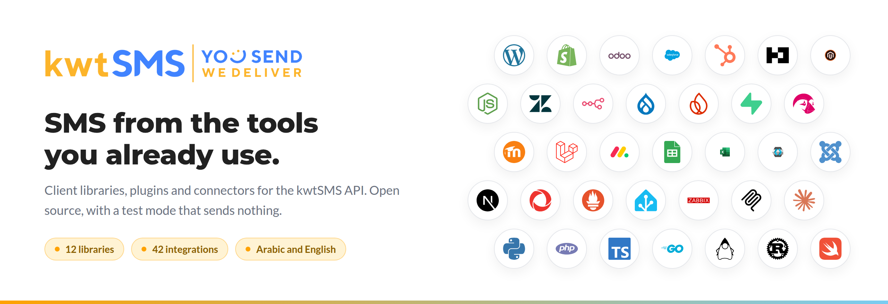

<!-- 2026-11-16 15:15 +03: org profile v2 (brand banner, logos, directory), Boss msg 923, q-org-profile -->
<picture>
  <source media="(prefers-color-scheme: dark)" srcset="https://raw.githubusercontent.com/kwtsms/.github/main/profile/assets/banner-dark.png">
  
</picture>

<p align="center">
  <a href="https://www.kwtsms.com/cportal/signup/"></a>&nbsp;
  <a href="https://www.kwtsms.com/api-documentation.html"></a>&nbsp;
  <a href="https://www.kwtsms.com/developers.html"></a>&nbsp;
  <a href="https://www.kwtsms.com/support.html"></a>
</p>

kwtSMS sends SMS, OTP codes and alerts to all four Kuwait networks (Zain, Ooredoo, stc, Virgin) and to more than 220 countries. One credit is one SMS and credits never expire. Every account gets free test credits, and `test=1` checks a send without delivering it.

```bash
curl -X POST https://www.kwtsms.com/API/send/ \
  -H "Content-Type: application/json" \
  -d '{"username": "API_USER", "password": "API_PASS",
       "sender": "KWT-SMS", "mobile": "965XXXXXXXX",
       "message": "Hello from kwtSMS", "test": "1"}'
```

## Client libraries

<table>
<tr>
<td align="center" width="240"><a href="https://github.com/kwtsms/kwtsms-php"><br><b>PHP</b></a><br><sub><code>composer require kwtsms/kwtsms-php</code></sub></td>
<td align="center" width="240"><a href="https://github.com/kwtsms/kwtsms-python"><br><b>Python</b></a><br><sub><code>pip install kwtsms</code></sub></td>
<td align="center" width="240"><a href="https://github.com/kwtsms/kwtsms-js"><br><b>JavaScript / TypeScript</b></a><br><sub><code>npm install kwtsms</code></sub></td>
<td align="center" width="240"><a href="https://github.com/kwtsms/kwtsms-go"><br><b>Go</b></a><br><sub><code>go get github.com/kwtsms/kwtsms-go</code></sub></td>
</tr>
<tr>
<td align="center" width="240"><a href="https://github.com/kwtsms/kwtsms-java"><br><b>Java</b></a><br><sub><code>JitPack</code></sub></td>
<td align="center" width="240"><a href="https://github.com/kwtsms/kwtsms-kotlin"><br><b>Kotlin</b></a><br><sub><code>JitPack</code></sub></td>
<td align="center" width="240"><a href="https://github.com/kwtsms/kwtsms-csharp"><br><b>C# / .NET</b></a><br><sub><code>dotnet add package KwtSMS</code></sub></td>
<td align="center" width="240"><a href="https://github.com/kwtsms/kwtsms-ruby"><br><b>Ruby</b></a><br><sub><code>gem install kwtsms</code></sub></td>
</tr>
<tr>
<td align="center" width="240"><a href="https://github.com/kwtsms/kwtsms-rust"><br><b>Rust</b></a><br><sub><code>cargo add kwtsms</code></sub></td>
<td align="center" width="240"><a href="https://github.com/kwtsms/kwtsms-swift"><br><b>Swift</b></a><br><sub><code>Swift Package Manager</code></sub></td>
<td align="center" width="240"><a href="https://github.com/kwtsms/kwtsms-dart"><br><b>Dart / Flutter</b></a><br><sub><code>dart pub add kwtsms</code></sub></td>
<td align="center" width="240"><a href="https://github.com/kwtsms/kwtsms-zig"><br><b>Zig</b></a><br><sub><code>zig fetch</code></sub></td>
</tr>
</table>

## Integrations

### Online stores

<table>
<tr><td width="44" align="center"></td><td width="250"><a href="https://github.com/kwtsms/kwtsms-wordpress"><b>WordPress and WooCommerce</b></a></td><td width="660">The open-source website builder, and the store plugin that runs on it</td></tr>
<tr><td width="44" align="center"></td><td width="250"><a href="https://github.com/kwtsms/kwtsms-shopify"><b>Shopify</b></a></td><td width="660">Hosted platform for running an online store</td></tr>
<tr><td width="44" align="center"></td><td width="250"><a href="https://github.com/kwtsms/kwtsms-magento"><b>Magento (Adobe Commerce)</b></a></td><td width="660">Open-source e-commerce platform for large catalogs, owned by Adobe</td></tr>
<tr><td width="44" align="center"></td><td width="250"><a href="https://github.com/kwtsms/kwtsms-opencart"><b>OpenCart</b></a></td><td width="660">Free, open-source PHP shopping cart</td></tr>
<tr><td width="44" align="center"></td><td width="250"><a href="https://github.com/kwtsms/kwtsms-prestashop"><b>PrestaShop</b></a></td><td width="660">Open-source e-commerce software for independent stores</td></tr>
<tr><td width="44" align="center"></td><td width="250"><a href="https://github.com/kwtsms/kwtsms-ecwid"><b>Ecwid (Lightspeed)</b></a></td><td width="660">Online store you can add to an existing website or social page</td></tr>
<tr><td width="44" align="center"></td><td width="250"><a href="https://github.com/boxlinknet/kwtsms-cs-cart"><b>CS-Cart</b></a></td><td width="660">PHP shopping cart and multi-vendor marketplace software</td></tr>
</table>

### Business apps, CRM and help desk

<table>
<tr><td width="44" align="center"></td><td width="250"><a href="https://github.com/kwtsms/kwtsms-odoo"><b>Odoo</b></a></td><td width="660">Open-source suite of business apps: sales, invoicing, inventory and more</td></tr>
<tr><td width="44" align="center"></td><td width="250"><a href="https://github.com/kwtsms/kwtsms-salesforce"><b>Salesforce</b></a></td><td width="660">Cloud CRM for sales and service teams</td></tr>
<tr><td width="44" align="center"></td><td width="250"><a href="https://github.com/kwtsms/kwtsms-hubspot"><b>HubSpot</b></a></td><td width="660">CRM platform for marketing, sales and customer service</td></tr>
<tr><td width="44" align="center"></td><td width="250"><a href="https://github.com/kwtsms/kwtsms-zoho"><b>Zoho CRM</b></a></td><td width="660">Cloud CRM, part of the Zoho business suite</td></tr>
<tr><td width="44" align="center"></td><td width="250"><a href="https://github.com/kwtsms/kwtsms-krayin"><b>Krayin</b></a></td><td width="660">Open-source CRM built on Laravel</td></tr>
<tr><td width="44" align="center"></td><td width="250"><a href="https://github.com/kwtsms/kwtsms-monday"><b>monday.com</b></a></td><td width="660">Work management platform with boards and automations</td></tr>
<tr><td width="44" align="center"></td><td width="250"><a href="https://github.com/kwtsms/kwtsms-zendesk"><b>Zendesk</b></a></td><td width="660">Customer service and ticketing software</td></tr>
<tr><td width="44" align="center"></td><td width="250"><a href="https://github.com/kwtsms/kwtsms-freshdesk"><b>Freshdesk</b></a></td><td width="660">Help desk software from Freshworks</td></tr>
<tr><td width="44" align="center"></td><td width="250"><a href="https://github.com/kwtsms/kwtsms-freescout"><b>FreeScout</b></a></td><td width="660">Open-source help desk and shared inbox</td></tr>
<tr><td width="44" align="center"></td><td width="250"><a href="https://github.com/kwtsms/kwtsms-osticket"><b>osTicket</b></a></td><td width="660">Open-source support ticket system</td></tr>
<tr><td width="44" align="center"></td><td width="250"><a href="https://github.com/kwtsms/kwtsms-whmcs"><b>WHMCS</b></a></td><td width="660">Billing and automation platform for web hosting companies</td></tr>
</table>

### Websites and learning

<table>
<tr><td width="44" align="center"></td><td width="250"><a href="https://github.com/kwtsms/kwtsms-drupal"><b>Drupal</b></a></td><td width="660">Open-source CMS for complex, structured websites</td></tr>
<tr><td width="44" align="center"></td><td width="250"><a href="https://github.com/kwtsms/kwtsms-joomla"><b>Joomla</b></a></td><td width="660">Open-source CMS for websites and portals</td></tr>
<tr><td width="44" align="center"></td><td width="250"><a href="https://github.com/kwtsms/moodle-local_kwtsms"><b>Moodle</b></a></td><td width="660">Open-source learning platform for schools, universities and training</td></tr>
</table>

### Automation and spreadsheets

<table>
<tr><td width="44" align="center"></td><td width="250"><a href="https://github.com/kwtsms/kwtsms-n8n"><b>n8n</b></a></td><td width="660">Workflow automation tool you can self-host</td></tr>
<tr><td width="44" align="center"></td><td width="250"><a href="https://github.com/kwtsms/kwtsms-mspowerauto"><b>Power Automate</b></a></td><td width="660">Microsoft's service for automated workflows between apps</td></tr>
<tr><td width="44" align="center"></td><td width="250"><a href="https://github.com/kwtsms/kwtsms-googlesheets"><b>Google Sheets</b></a></td><td width="660">Google's online spreadsheets</td></tr>
<tr><td width="44" align="center"></td><td width="250"><a href="https://github.com/kwtsms/kwtsms-msexcel"><b>Microsoft Excel</b></a></td><td width="660">Microsoft's spreadsheet app</td></tr>
</table>

### App backends, frameworks and sign-in

<table>
<tr><td width="44" align="center"></td><td width="250"><a href="https://github.com/kwtsms/kwtsms-laravel"><b>Laravel</b></a></td><td width="660">PHP web framework</td></tr>
<tr><td width="44" align="center"></td><td width="250"><a href="https://github.com/kwtsms/kwtsms-notification-channel"><b>Laravel Notifications</b></a></td><td width="660">The notification system built into Laravel</td></tr>
<tr><td width="44" align="center"></td><td width="250"><a href="https://github.com/kwtsms/kwtsms-firebase"><b>Firebase</b></a></td><td width="660">Google's app backend: database, sign-in and cloud functions</td></tr>
<tr><td width="44" align="center"></td><td width="250"><a href="https://github.com/kwtsms/kwtsms-supabase"><b>Supabase</b></a></td><td width="660">Open-source Postgres backend with sign-in and edge functions</td></tr>
<tr><td width="44" align="center"></td><td width="250"><a href="https://github.com/kwtsms/kwtsms-convex"><b>Convex</b></a></td><td width="660">Reactive backend for TypeScript apps</td></tr>
<tr><td width="44" align="center"></td><td width="250"><a href="https://github.com/kwtsms/kwtsms-better-auth"><b>Better Auth</b></a></td><td width="660">Authentication library for TypeScript apps</td></tr>
<tr><td width="44" align="center"></td><td width="250"><a href="https://github.com/kwtsms/kwtsms-nextjs-otp"><b>Next.js</b></a></td><td width="660">React framework for web apps</td></tr>
<tr><td width="44" align="center"></td><td width="250"><a href="https://github.com/kwtsms/kwtsms-auth-relay"><b>Clerk and Neon Auth</b></a></td><td width="660">Hosted user sign-in services</td></tr>
<tr><td width="44" align="center"></td><td width="250"><a href="https://github.com/kwtsms/kwtsms-otp"><b>Node.js, Bun and Workers</b></a></td><td width="660">JavaScript runtimes for servers and the edge</td></tr>
<tr><td width="44" align="center"></td><td width="250"><a href="https://github.com/kwtsms/kwtsms-keycloak"><b>Keycloak</b></a></td><td width="660">Open-source identity and access management server</td></tr>
</table>

### Monitoring and smart home

<table>
<tr><td width="44" align="center"></td><td width="250"><a href="https://github.com/kwtsms/kwtsms-zabbix"><b>Zabbix</b></a></td><td width="660">Open-source monitoring for networks, servers and applications</td></tr>
<tr><td width="44" align="center"></td><td width="250"><a href="https://github.com/kwtsms/kwtsms-nagios"><b>Nagios and Icinga</b></a></td><td width="660">Open-source infrastructure monitoring and alerting</td></tr>
<tr><td width="44" align="center"></td><td width="250"><a href="https://github.com/kwtsms/kwtsms-prometheus"><b>Prometheus</b></a></td><td width="660">Open-source metrics and alerting toolkit</td></tr>
<tr><td width="44" align="center"></td><td width="250"><a href="https://github.com/kwtsms/kwtsms-homeassistant"><b>Home Assistant</b></a></td><td width="660">Open-source home automation platform</td></tr>
</table>

### AI assistants and the terminal

For AI tools, start with the MCP server (no install, test mode by default, the AI never sees your password) and add
the kwtSMS skill next to it. Use the CLI for terminal agents, scripts and cron.

<table>
<tr><td width="44" align="center"></td><td width="250"><a href="https://github.com/kwtsms/kwtsms-mcp"><b>MCP</b></a></td><td width="660">Open protocol that connects AI assistants to outside tools</td></tr>
<tr><td width="44" align="center"></td><td width="250"><a href="https://github.com/kwtsms/kwtsms-ai"><b>Claude Code</b></a></td><td width="660">Anthropic's coding assistant for the terminal</td></tr>
<tr><td width="44" align="center"></td><td width="250"><a href="https://github.com/kwtsms/kwtsms-cli"><b>Your terminal</b></a></td><td width="660">Shell scripts, cron jobs and CI pipelines</td></tr>
</table>

---

<p align="center">
  Missing your platform? <a href="https://www.kwtsms.com/support.html">Tell us</a>, or build on the <a href="https://www.kwtsms.com/api-documentation.html">API</a> with one of the libraries above.<br>
  <sub>kwtSMS is a service of BoxLink, Kuwait.</sub>
</p>
